# Sato–Morrison collision prototype

Conserving magnetic moment restricts how a plasma can relax. This fixed-field JAX prototype follows [Sato & Morrison (2025)](https://doi.org/10.1063/5.0289410), reproduces their local linear Eq. (181), and studies explicit nonlinear and finite-range extensions. Numerical values below use normalized units.

## Magnetic coordinates

A charged particle spirals around a magnetic field. Averaging over that rapid orbit gives a guiding center. Its state consists of position **X**, signed parallel velocity **u**, and magnetic moment **μ**. The distribution **f(X,u,μ,t)** counts guiding centers in phase space.

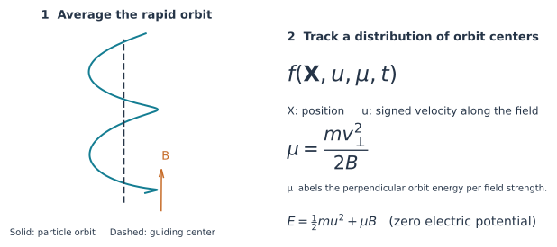

Here **m** is mass, **q** is charge and **B** is field strength. Magnetic moment measures perpendicular kinetic energy divided by B. Ideal motion approximately preserves μ when the gyroradius and gyroperiod are small compared with the field's spatial and temporal scales. The constrained collision operator preserves μ exactly.

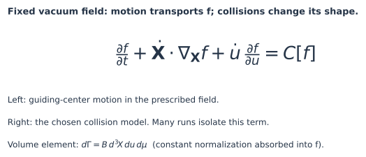

The transport terms move particles through the prescribed field; **C[f]** redistributes their population through collisions. For the vacuum fields used here, the volume element is **B d³X du dμ**. Most nonuniform runs isolate C[f]. The toroidal calculation also includes compatible ideal motion.

## Conservation constraints

The operator conserves number, total energy and the entire magnetic-moment distribution **G(μ)**. Each μ bin retains its population after integrating over position and parallel velocity.

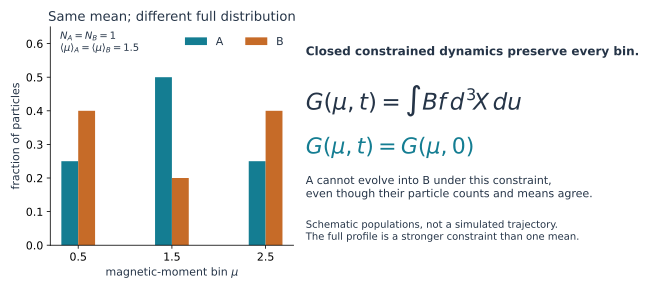

Both populations above have N = 1 and mean μ = 1.5. Their bin populations differ, so magnetic-moment-preserving collisions cannot connect them. Entropy can increase within the permitted states; the constraints and the operator's nullspace determine which states are accessible.

## Uniform field: exact solution

Write a small perturbation as a density modulation of the homogeneous reference **f₀**, plus a remainder **g** whose velocity integral vanishes. In the local linear model, the density modulation survives and the remainder diffuses across the field.

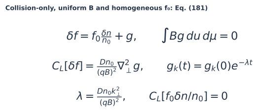

Here n₀ and δn are velocity integrals with measure B du dμ; k⊥ is the perpendicular wavenumber. The calculation assumes constant electric potential and collision-only evolution. **D is a prescribed coefficient**, so the time axis is normalized model time.

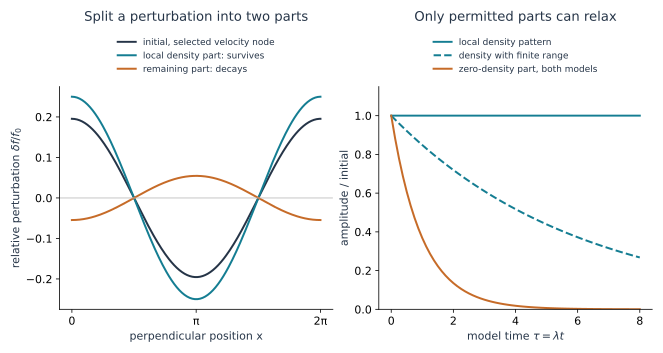

In the finite-range extension, a Gaussian interaction range **a** changes the density-branch rate to **λρ = λ[1 − exp(−a²k⊥²/2)]**. Since λ scales as k⊥², the long-wave density rate scales as k⊥⁴. The shape branch retains rate λ. The plotted range gives λρ/λ = 0.165.

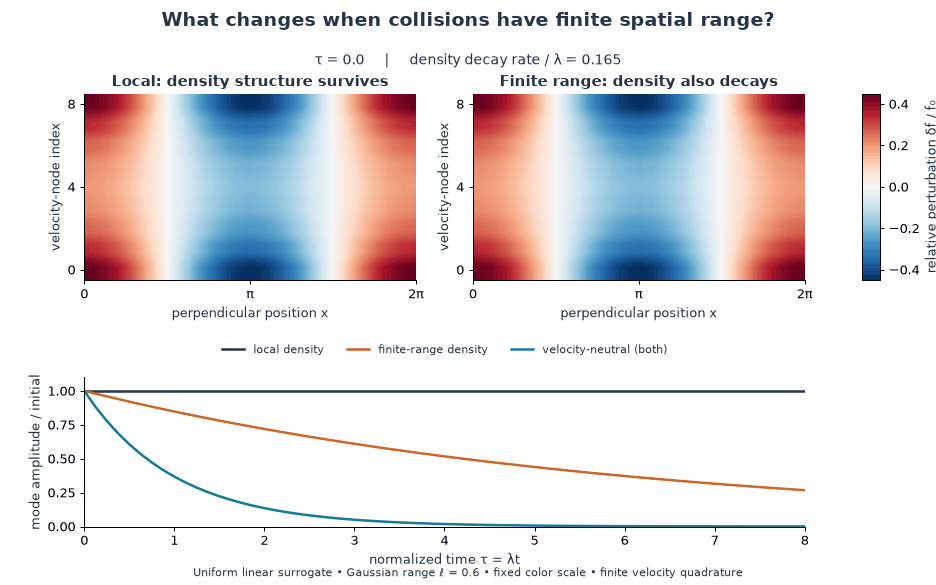

Rows represent velocity-quadrature nodes. The animation uses saved operator evolution checked against the exact modes; maximum discrepancy is **3.08×10⁻¹⁵**. [Inputs and arrays](results/visual_summary/metadata.json)

## Discrete nonlinear model

The nonlinear kernel acts on differences of guiding-center derivatives. **Aᵢh** is the discrete action of J∇h, expressed in a common Cartesian η = μB chart. Here **J** is the guiding-center Poisson matrix. The energy direction ξ uses the same derivative as every test function. Projecting perpendicular to ξ enforces discrete energy conservation.

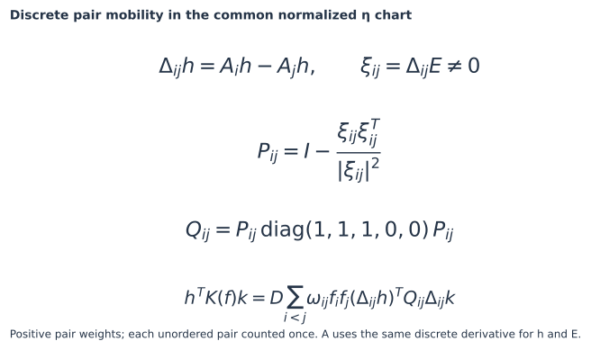

The positive weights ωᵢⱼ contain quadrature and, for nonlocal interactions, the spatial range kernel. The diagonal matrix selects the three spatial components before energy projection. Local pairs share one position. Each unordered pair enters once. The uniform zero-direction limit is derived analytically; an unresolved zero direction in a nonuniform field causes an error.

Source Eq. (119) closes a pair distribution into two species distributions and retains a full interaction tensor. The displayed Q defines the project's simpler nonlinear kernel. Eq. (181) supplies the uniform linear reference.

## Implicit time integration

Let **nᵢ = wᵢfᵢ** be a node's population, with positive quadrature weight wᵢ. The matrix K is symmetric and positive semidefinite. Its null vectors include the constant, discrete energy and every μ-bin indicator χₐ.

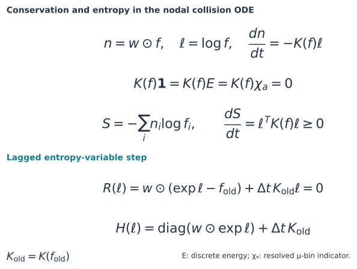

Small nonlinear reference problems use a second-order discrete-gradient step. The large nonuniform runs use the displayed first-order step, freezing K at the old density. Newton corrections use matrix-free Hessian products and SOLVAX PCG. Acceptance checks include the true linear residual, nonlinear residual, positive population and objective decrease. Failed steps raise an error and retain their last accepted state.

## Comparing collision operators

Start every model from the same uniform plasma: perpendicular temperature **T⊥ = 1.15**, parallel temperature **T∥ = 0.7**, zero mean velocity and **n = m = B = 1**. Here F is the density in all three physical velocity dimensions.

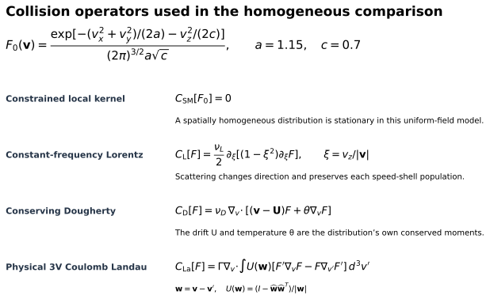

We match the initial pressure-anisotropy decay of Lorentz and Dougherty to the independently calculated Landau slope: **α = 0.493595**, **νL = α/3**, **νD = α/2**, **τ = αt**. This choice makes their entire pressure curves coincide. The uniform constrained state remains stationary.

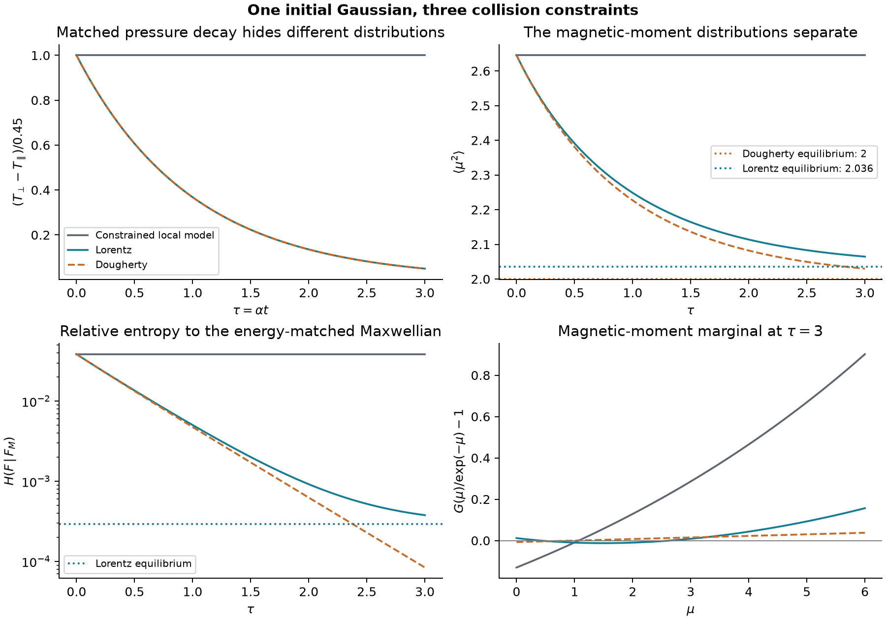

Pressure alone misses the difference. Lorentz preserves the number of particles at every speed and approaches an isotropic, non-Maxwellian distribution. Dougherty redistributes speeds and approaches a Maxwellian. Their limiting **⟨μ²⟩** values are **2.036** and **2**, respectively; the constrained model retains **2.645**. Lorentz retains a relative-entropy distance **H = 2.94145×10⁻⁴** from the Maxwellian.

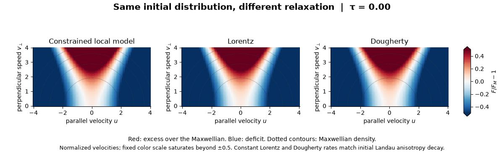

Red shows excess population relative to the energy-matched Maxwellian; blue shows a deficit. The plots use analytical mode-time factors and checked angular reconstruction. Final quadrature, tail and angular refinements change the reported observables by less than **6×10⁻¹²** in normalized units. A coarse angular reconstruction that produced negative tail densities remains recorded as a failure. [Inputs, arrays and checks](results/operator_comparison/summary.json)

The initial higher-moment rates already distinguish the conventional operators. Here μ = (vₓ² + vᵧ²)/2, and the Landau coefficient is Γ = 1 in normalized units:

| Initial rate | Constrained | Lorentz | Dougherty | Physical 3V Landau |
|---|---:|---:|---:|---:|
| Pressure anisotropy | 0 | −0.222118 | −0.222118 | −0.222118 |
| Mean squared magnetic moment | 0 | −0.340581 | −0.340581 | −0.260753 |
| Fourth speed moment | 0 | 0 | −0.266541 | −0.133271 |

Independent spherical and Laplace integrals for the Landau entries agree to **4.14×10⁻¹⁴**. Nonzero fourth-cumulant rates show that the evolving distribution leaves the Gaussian family. [Initial-rate derivation and evidence](results/operator_comparison/physical_initial_rates.json)

The Lorentz frequency here is constant; physical Coulomb deflection has a speed-dependent frequency. Matching one initial slope is a comparison convention and supplies no physical Sato–Morrison coefficient. The full Landau density solver passes independent finite-grid matrix, nullspace, conservation, entropy and timestep-order checks. The velocity-space consistency test below determines how much those checks establish. [Independent 3V matrix audit](results/landau_evolution/independent_gram_audit.json)

### Checking the full Landau collision term

A collision operator moves particles between velocities. Red regions below gain population; blue regions lose it. Starting from the same Gaussian, we can calculate this initial redistribution independently through a one-dimensional Coulomb integral. The other panels apply the discrete Landau operator to that distribution.

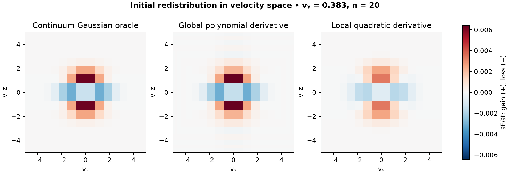

Matching a few moments can conceal distribution errors. Both derivatives conserve number, momentum and energy and give the same initial pressure rate. At **20³ nodes**, that rate has **0.86% error**, while the full collision-term errors are **9.67%** and **39.39%**. The error measure integrates the absolute difference over physical velocity volume and divides by the reference collision term’s absolute integral.

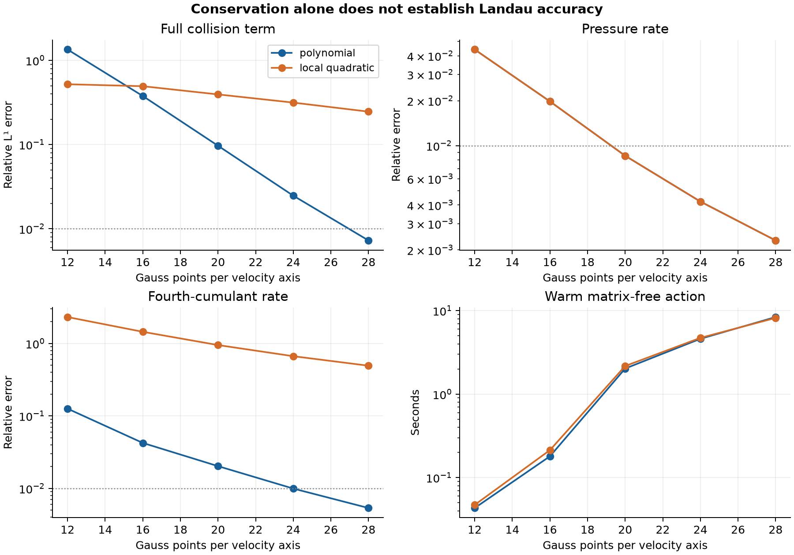

At **28³ nodes**, polynomial differentiation reaches **0.73% full-term error**, **0.23% pressure-rate error** and **0.54% fourth-cumulant-rate error**. Large relative errors remain at low-density tail nodes. The local quadratic option still has **24.59% full-term error**. It is retained as a diagnostic of the difference between conservation and accuracy. The polynomial action takes **8.38 s** on the recorded M4 run; the two methods have not reached matched accuracy, so their timings establish no speedup.

An independent diagnostic supplies the exact velocity-space particle flux to each discrete derivative. The local method still has **24.37% error**, close to its **24.59%** total. The main defect is therefore in the finite derivative and boundary reconstruction; refining the collision integral alone will not resolve it. [Flux and derivative checks](results/landau_consistency/independent_flux_audit.json)

This initial-rate test motivated the velocity quadrature used below. Example 30 saves every refinement and exits with a visible failure because the declared 1% target is unresolved for the local option. [Inputs and measured errors](results/landau_consistency/summary.json) · [Independent array audit](results/landau_consistency/independent_audit.json) · [Independent continuum derivation and checks](results/landau_evolution/independent_strong_audit.json)


### Evolving the full Landau distribution

Each velocity node carries an independent density. Gauss–Hermite nodes concentrate resolution near populated velocities; their weights are converted to physical velocity volume before assembling the Coulomb operator. The distribution can leave the initial Gaussian family.

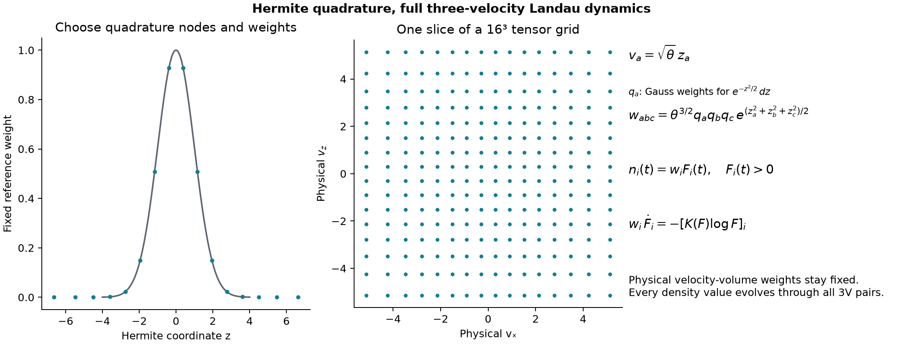

The sampling scale is **θ = 0.6**, independent of the plasma temperatures. Initial collision-term errors against the continuum Gaussian integral are **0.778% on 16³ nodes** and **0.475% on 20³ nodes**. Every accepted step solves the full discrete collision equation and conserves its raw number, momentum and energy.

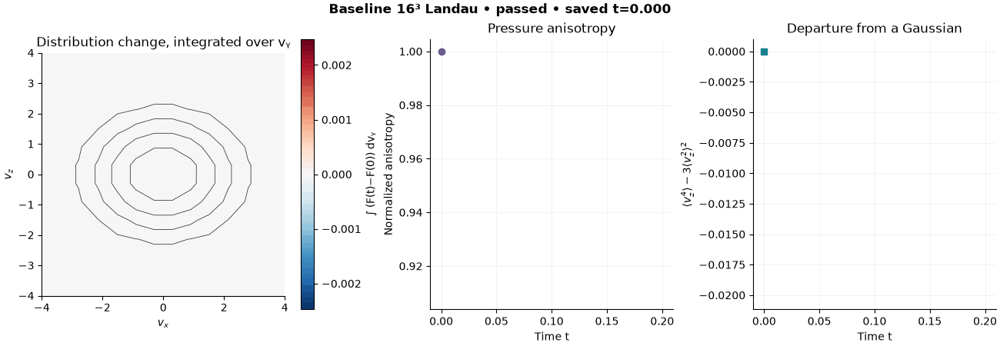

The movie follows eight accepted **16³-node** steps, **Δt = 0.025**, through **t = 0.2**. Pressure anisotropy falls from **0.45 to 0.408796**. The fourth cumulants reach **(0.020546, 0.020546, −0.020160)**, from sampled initial magnitudes below **1.54×10⁻⁵**. A Gaussian with the same mean and covariance has zero fourth cumulants; the simulation resolves a change in distribution shape beyond its pressure change.

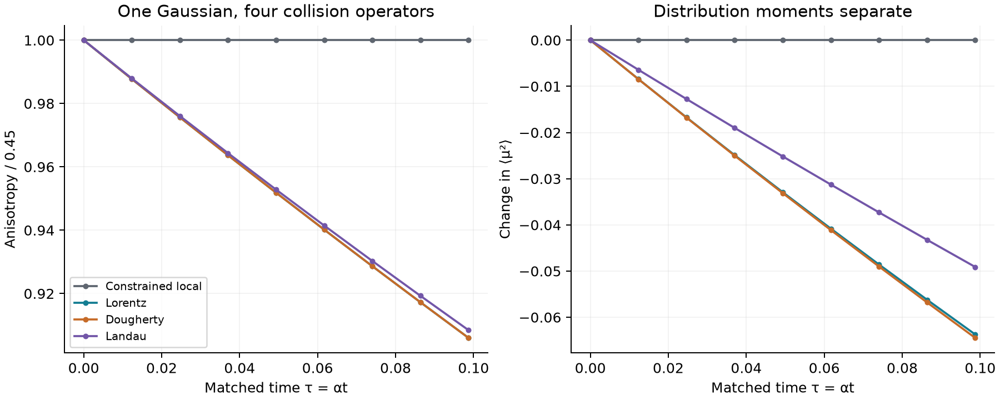

Matching the initial pressure slope leaves different distribution evolution. At **τ = αt = 0.098719**, Landau retains more of the initial squared magnetic moment than either conventional control. Lorentz preserves the fourth speed moment; Dougherty and Landau change it at different rates. Only the constrained model preserves the entire magnetic-moment marginal.

| At t = 0.2 | T⊥ − T∥ | ⟨μ²⟩ | ⟨\|v\|⁴⟩ |
|---|---:|---:|---:|
| Constrained | 0.450000 | 2.645000 | 15.270000 |
| Lorentz | 0.407699 | 2.581282 | 15.270000 |
| Dougherty | 0.407699 | 2.580536 | 15.221624 |
| Landau | 0.408796 | 2.595895 | 15.245989 |

Landau entries use the saved nodal populations; the other entries use the exact homogeneous control formulas. The small initial quadrature offsets are retained in every refinement comparison.

### Trajectory refinement

Each refinement is compared at every shared saved time. The density error is the integrated absolute difference between two runs, divided by the baseline's actual change from its initial density. The moment errors use the same change-based normalization. Thus a small relaxation signal still has to be resolved.

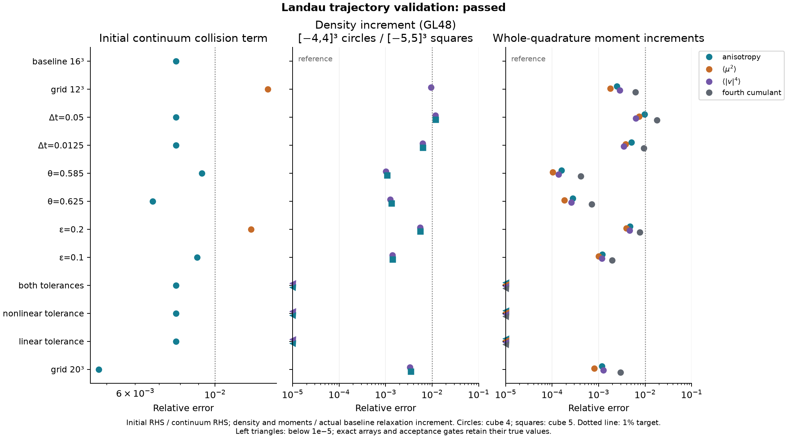

| Refinement | Density change | Largest moment change |
|---|---:|---:|
| Velocity grid: 16³ → 20³ | 0.345% | 0.296% |
| Timestep: 0.025 → 0.0125 | 0.628% | 0.931% |
| Sampling scale: 0.6 → 0.585 / 0.625 | 0.132% | 0.072% |
| Coulomb softening: 0 → 0.1 | 0.140% | 0.196% |
| Separate linear / nonlinear tolerances | <10⁻⁸% | <10⁻⁸% |

These are the largest changes over shared times; the density column uses 48-point quadrature on both boxes. All required comparisons pass the **1%** target. Coarse grid, doubled timestep and larger softening rows remain diagnostic, with their failed checks shown in the figure. The three timestep levels give an observed order of **0.963**, consistent with the first-order scheme over this interval.

Density comparisons cover **[−4,4]³** and **[−5,5]³**, with independent 32-, 48- and 64-point quadrature in each velocity direction. The scale scan moves the outer nodes and tests tail sensitivity; the reported tail populations and finite boxes do not supply a rigorous infinite-domain error bound. The kernel scan approaches the unsoftened Coulomb kernel. Separate linear and nonlinear tolerance reductions leave the observables unchanged to the reported accuracy.

An independent NumPy/SciPy reconstruction passes **all 100 saved advances**: maximum original root residual **3.82×10⁻¹¹**, raw number/momentum/energy drift **3.12×10⁻¹⁰**, and corrected entropy-balance defect **1.46×10⁻¹⁶**. All saved populations are positive.

The full campaign takes **2,011.9 s** with **602.1 MB** peak process memory on the shared Apple M4; the baseline and fine-grid cases take **26.4 s** and **1,725.6 s**. These observed costs include their setup and compilation. [Inputs, states and comparisons](results/landau_trajectory_dt_refined/summary.json) · [Independent replay](results/landau_trajectory_dt_refined/independent_portable_audit.json) · [Execution and cost record](results/landau_trajectory_dt_refined/execution_receipt.json)

The earlier **Δt = 0.05** study failed the unchanged 1% timestep target; it remains [archived with its checks](results/landau_trajectory_refined/summary.json). The earlier stalled fine-grid solve and all accepted states also remain [available](results/landau_trajectory/summary.json). The present result establishes short-time numerical agreement under the declared refinements. It does not determine a magnetized collision coefficient, long-time equilibrium or dipole confinement lifetime.

## Fields, boundaries and simulations

| Field | Domain and boundary treatment |
|---|---|
| Uniform | Periodic perpendicular coordinate; exact Fourier controls |
| Harmonic mirror | Cartesian box; natural zero collision flux |
| Vacuum toroidal | Cylindrical coordinates with the R Jacobian; periodic angle and tangent ideal motion |
| Dipole | Cartesian box excluding the field singularity; natural zero collision flux |
| Controlled nonaxisymmetric | Vacuum perturbation of the dipole; the same collision-only box treatment |

For fixed μ, perpendicular energy is **E⊥ = μB**: the same moment represents different energies where the field is stronger or weaker. The orange box marks the dipole domain used below.

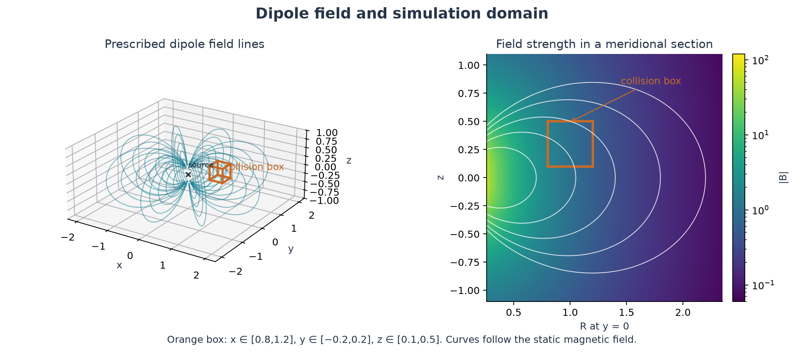

The three-field pilot starts from **f = exp[−E − 0.2μ + 0.1u sin(πy/0.4)]** on x ∈ [0.8,1.2], y ∈ [−0.2,0.2], z ∈ [0.1,0.5], u ∈ [−4,4], μ ∈ [0,20]. It uses **5³ × 25 × 13 = 40,625 nodes**, D = 0.1 and four steps of Δt = 0.005.

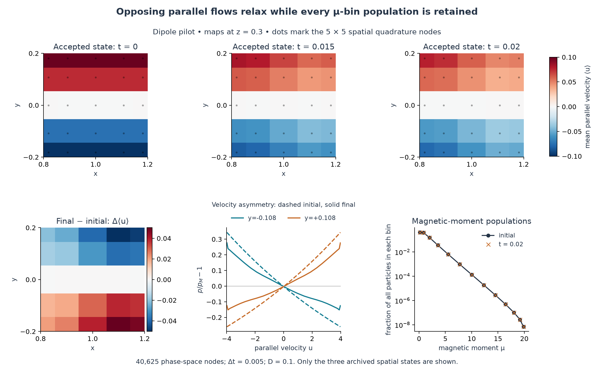

Red and blue regions flow along and against the local field. Their speeds weaken unevenly across the box. The lower curves show the local velocity density **p(u|X)** relative to the normalized Gaussian **pM ∝ exp(−u²/2)**. Every global μ-bin population is retained to **2.22×10⁻¹⁵** relatively. Dots mark the spatial quadrature nodes; the three maps are the archived states at **t = 0, 0.015, 0.02**. [Plotted arrays and checks](results/spatial_relaxation/summary.json)

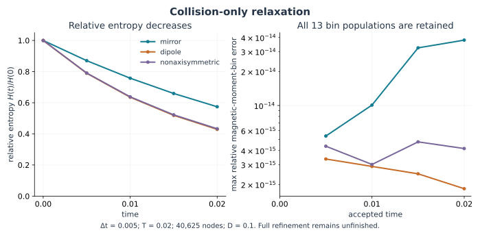

Here **H = Σᵢ wᵢ[fᵢ log(fᵢ/f⋆ᵢ) − fᵢ + f⋆ᵢ]**, with f⋆ proportional to exp(−E − 0.2μ) and normalized to the same particle number. It measures departure from this stationary reference, which need not be reachable. The curves use the accepted steps' entropy changes and the conserved moments. Independent pair calculations check the final residual and entropy identity. Two preconditioners agree within **1.50×10⁻¹²** in the weighted log-density norm. [Pilot comparison](results/nonuniform_spatial_blocks/preconditioner_comparison.json)

The mirror has a separate **15-run refinement study**: eight final observable changes are below 1%, with a maximum of **0.197%**. Coarse timesteps retain **2–3% bias**. Dipole and nonaxisymmetric grid/tail/timestep refinement is unfinished; the current campaign includes rejected steps in extreme tails. [Refinement ledger](results/nonuniform_spatial_blocks_full/summary.json)

## Geometry-dependent constraints

In the local dipole model, collisions preserve the population on each magnetic flux surface. Two distributions can therefore agree in number, energy, G(μ) and mean flux while retaining different flux distributions.

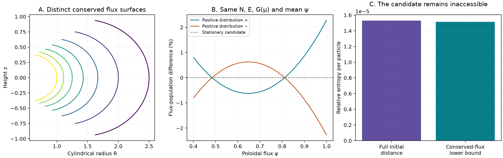

This construction gives a relative-entropy floor of **1.5141×10⁻⁵ per particle**. Joint quadrature refinement changes the bound by **1.1×10⁻¹⁰** relatively. The result applies to the specified local collision model and domain. A physical confinement lifetime still requires compatible ideal boundaries and calibrated collision physics.

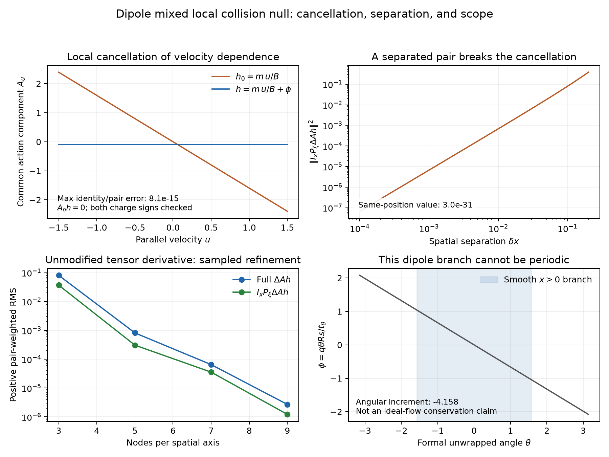

The mixed moment is conserved on an angular patch. Its angle dependence prevents a periodic extension; separated-pair interactions and ideal motion also change it.

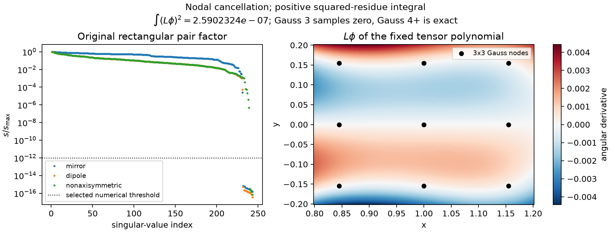

The finite-grid spectra retain every null mode. Three extra axisymmetric polynomial modes vanish at the sampled angular nodes; four-node quadrature detects their nonzero variation between nodes. They cannot be discarded to infer a continuum spectral gap.

## Direct particle encounters

Two repelling particles in a uniform field provide a physical check on magnetic-moment conservation. The incoming speeds and orbit-center separation are fixed while the phase around the spiral varies.

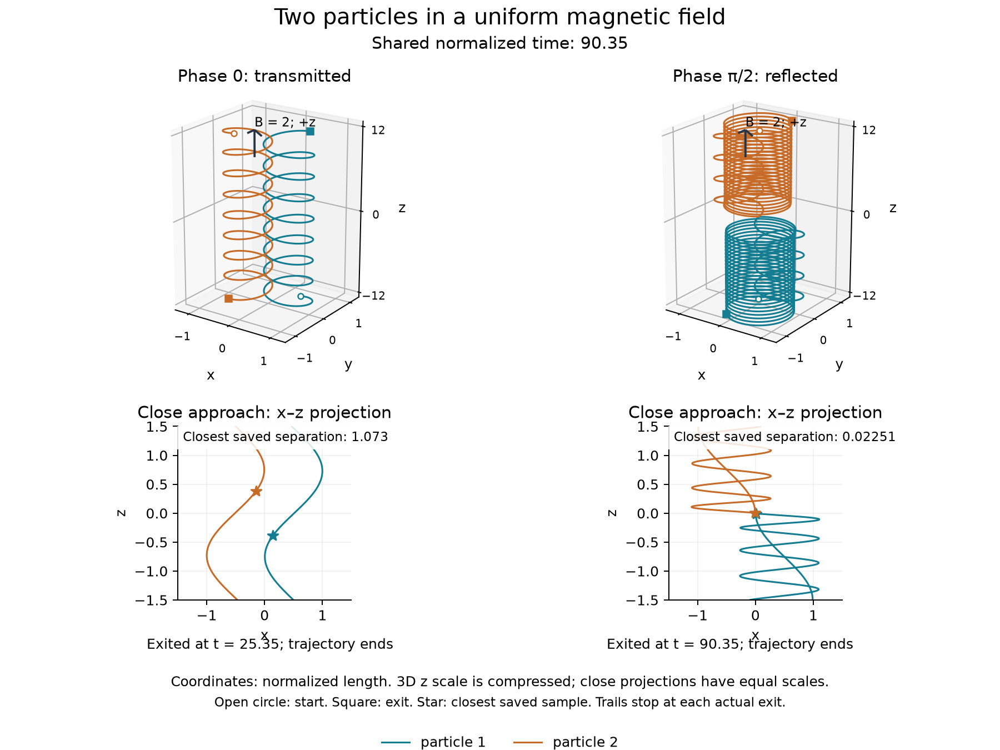

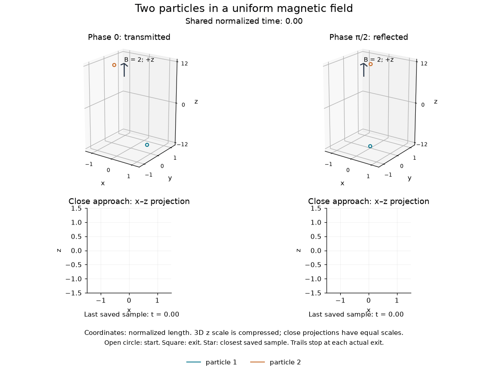

The left pair transmits; the right pair reflects. The lower projections resolve the close approach on equal spatial scales. The upper views compress the long z direction. Both encounters use the same clock, and each path stops at its outgoing event.

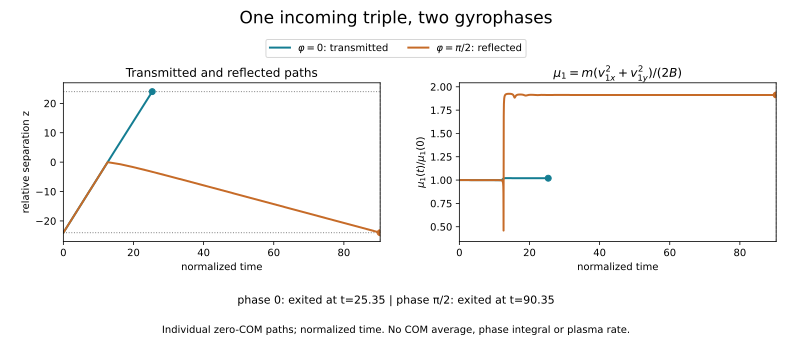

One path transmits at **t = 25.35**; the other reflects at **t = 90.35**. Their final magnetic moments are **1.020** and **1.912** times their initial values. Each curve stops at its outgoing event. These zero-center-of-mass paths lie outside a verified adiabatic/grazing regime. [Trajectory inputs and checks](results/encounter_movie/summary.json)

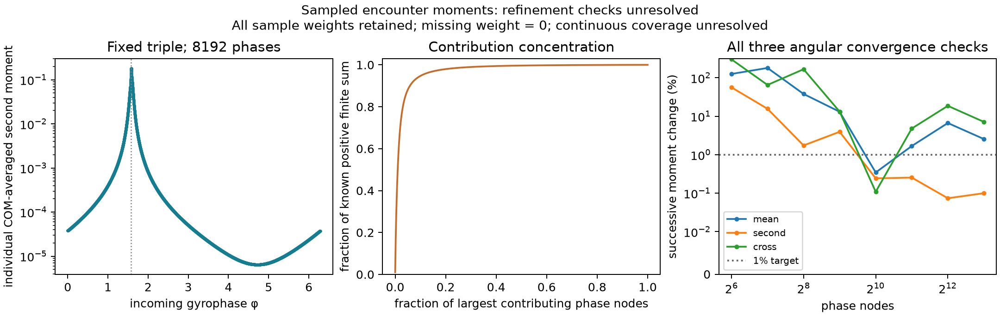

The extended calculation averages over Gaussian center-of-mass velocities and **8,192 incoming angles**. Subscripts label the two particles. The angular target requires two successive changes below 1%; the whole-grid half-step target is 0.1%.

| Averaged quantity | Angular change, 4,096 → 8,192 | Step change, 0.05 → 0.025 |
|---|---:|---:|
| Mean change, ⟨Δμ₁⟩ | **2.56%** | 5.90×10⁻⁸% |
| Squared change, ⟨(Δμ₁)²⟩ | 0.100% | 2.61×10⁻⁸% |
| Cross moment, ⟨Δμ₁Δμ₂⟩ | **7.14%** | 4.82×10⁻⁷% |

The mean and cross moment remain angularly under-resolved. **22 of 24** independent Cartesian trajectory checks pass; both checks at one newly selected angle fail and remain in the data. The run takes **477.4 s**, with **476.0 MB** peak process memory on the recorded M4. It exits nonzero. [Inputs, every trajectory and checks](results/encounter_phase/all_moments8192/summary.json)

The earlier 2,048-angle study passed its narrower second-moment criterion. That result is preserved in the [refinement history](results/encounter_phase/refined8192/summary.json). Continuous angular coverage and a physical collision rate remain unresolved.

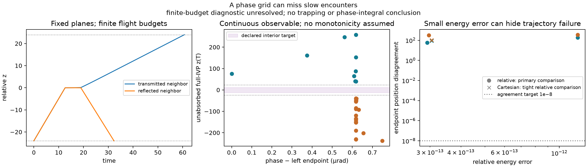

The original search gave opposite exits at two nearby starting states, despite energy errors near **10⁻¹²**. Independent Taylor integration at **50 and 70 decimal digits**, using the exact saved binary64 inputs, finds that **both states transmit**. Their exit times are **41.34** and **43.05**. The opposite-exit bracket was numerical.

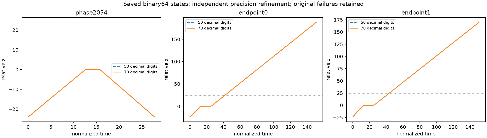

The two inputs differ by **6.98×10⁻¹⁵** in velocity; their positions differ by **18.06** at the saved final time. The two precision levels agree within **1.39×10⁻²¹** in position. A separate reflected path at phase index 2,054 is reproduced within **4.70×10⁻¹⁰** by tighter binary64 integration. These checks resolve the selected trajectories. The 8,192-angle mean and cross moment still need angular refinement. [Exact inputs, paths and precision comparisons](results/encounter_precision/saved_binary64/summary.json)

## Individual moments during a collision

Equal particles have two motions: their center of mass spirals freely, while their relative separation responds to the repulsive force. Recovering each particle's velocity requires both motions. Even a small rotation of the relative velocity can transfer perpendicular energy between the particles.

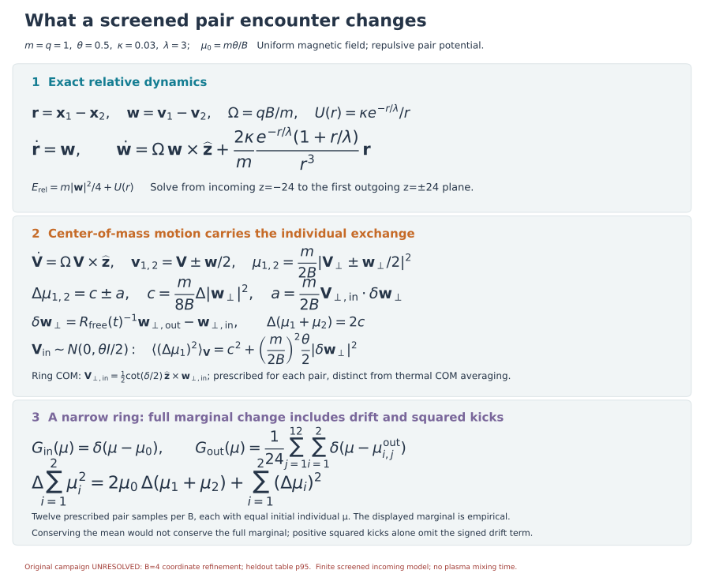

The pair potential is **U(r) = κ exp(−r/λ)/r**, with **m = q = 1**, **κ = 0.03**, **λ = 3** and single-particle thermal velocity variance **θ = 0.5**. This specifies a screened two-body model. The magnetic scan keeps the potential and incoming domain fixed: orbit-center separation **b ∈ [1.2, 2.4]**, relative parallel speed **u ∈ [0.7, 1.5]**, relative perpendicular speed **p ∈ [0.2, 0.8]**, and every gyrophase.

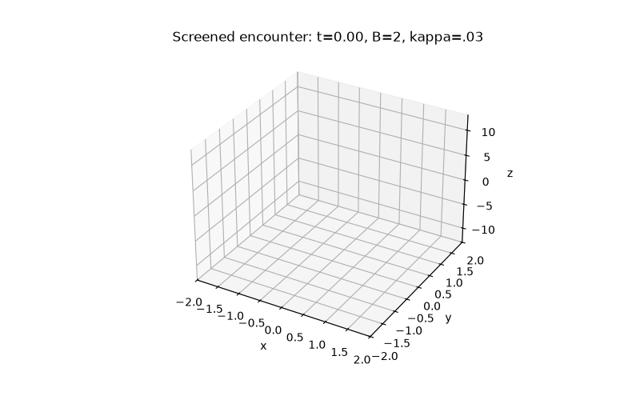

This movie follows one directly integrated pair at **B = 2**. Scattering statistics also average over independent Gaussian center-of-mass velocities. The incoming measure is the two-sided plane flux **2(2πb db) u Frel p dp du dφ**, where Frel has velocity covariance **2θI**. The band contains **11.64%** of the thermal crossing flux in its impact annulus; that fraction does not bound the omitted moment transport.

### A distribution-level check

Give both particles the same perpendicular speed **v₀ = 1**. Every incoming particle then has **μ₀ = mθ/B**. Choose three relative gyroangles and four common phases, and integrate each pair. Conservation of the entire μ marginal would require every outgoing particle to retain μ₀.

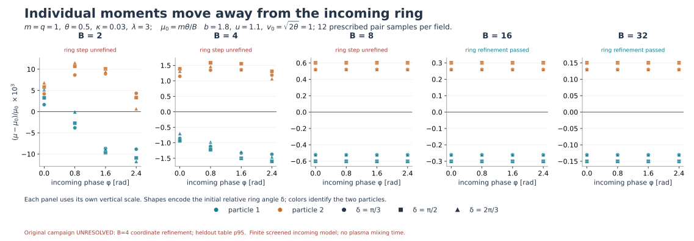

At **B = 16** and **32**, all **24** step-refinement comparisons pass. The largest individual fractional changes are **3.01×10⁻⁴** and **1.50×10⁻⁴**. The particles exchange moment in opposite directions. Their pair-total moment also has a small, measured correction, which is included in the second-moment budget below.

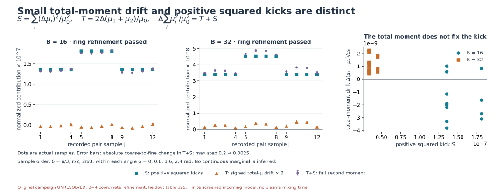

Every refined pair increases **μ₁² + μ₂²**, with the signal exceeding its refinement difference by at least **517**. Thus these selected encounters change the individual moment marginal. This tests the exact conservation imposed by the prototype. Its usefulness as an approximate plasma model still depends on the accumulated error over a measured relaxation time. These twelve pairs per field do not determine that time. [All ring states and refinement checks](results/physical_final_campaign/ring.json)

### Increasing the magnetic field

Define the moment-change measure **rμ = 2Dμμ/μ₀²** and the spatial measure **rR = ⟨|ΔR₁|²⟩ν/λ²**. Here ν weights incident pairs by their crossing flux, and R₁ is one particle's guiding center. Both quantities describe accumulated squared kicks in the stated band. Computing a kinetic mixing time additionally requires correlations and evolution of the population.

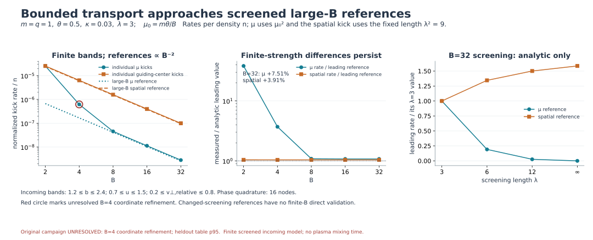

The right panel compares separate analytical screening choices; its horizontal positions are equally spaced categories.

Between **B = 16** and **32**, rμ and rR scale as **B<sup>−2.0004</sup>** and **B<sup>−1.99995</sup>**. Their ratio approaches **0.0283** on this band. The screened weak-force derivation predicts the same powers. The leading moment-exchange term cancels for unscreened Coulomb interactions, so this screened result cannot be transferred unchanged to that limit. The exchange mechanism is established in [Nersisyan & Zwicknagel (2009)](https://doi.org/10.1103/PhysRevE.79.066405).

At **B = 32**, the thermal gyroradius is **0.03125**, small compared with λ = 3. Its ratio to the Coulomb 90-degree impact scale nevertheless ranges from **0.328 to 1.386** on the sampled velocities. Close impacts are excluded. Assigning a plasma density also requires a consistent screening model; interpreting λ as a one-component Debye length fixes that density through **λ² = mθ/(4πnκ)**. The present calculation supplies conditional coefficients per partner density.

The original campaign saved **21,524** encounters in **872.94 s**. Its energy, boundary, active-step, weak-force, Cartesian-path and ring checks pass. Two checks require further refinement: the **B = 4** coordinate integral changes by **1.93%**, and the table's heldout 95th-percentile second-moment error is **7.89%** against a **5%** target. The bulk table RMS error is **0.355%**. [Original inputs, measured costs and failed gates](results/physical_final_campaign/summary.json)

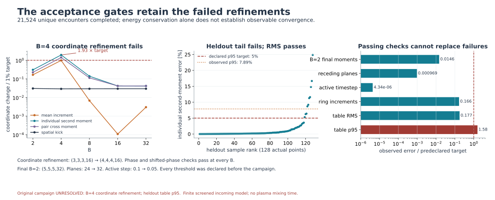

The focused followup resolves both failed checks with finer sampling. It retains the original result and its nonzero exit.

| Check | Final comparison | Result |
|---|---|---:|
| B = 4 integral | 5³ → 6³ nodes; 16 phases | Largest scaled moment change **0.00774%** |
| Table, original 128 heldout states | 7³ nodes; 32 phases | Second-moment RMS **0.0858%**; 95th percentile **1.88%** |
| Table, new 128 heldout states | Separate fixed seed | Second-moment RMS **0.114%**; 95th percentile **2.45%** |
| B = 32 moment amplitude | κ = 0.003 → 0.0015 | Analytical discrepancy **0.702% → 0.348%** |
| B = 32 spatial amplitude | Same weaker forces | Analytical discrepancy **0.374% → 0.187%** |

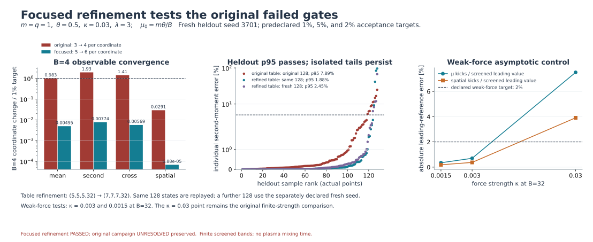

The middle error axis is linear near zero and logarithmic above that range, so all sampled errors remain visible.

Isolated relative table errors still reach **96.2%** and **67.2%** in the two samples. Those states have second moments about **0.03%** and **0.02%** of the largest sampled values. The full error distributions are visible above; the passing RMS and percentile criteria certify the declared statistics, while accuracy at every individual query remains open.

The original κ = 0.03 calculation differs from the weak-force moment prediction by **7.51%** at B = 32. Reducing κ by factors of ten and twenty reduces this discrepancy roughly in proportion. Doubling B from 16 to 32 had left it nearly constant. The force dependence is consistent with a finite-strength correction to the screened prediction. The followup costs **439.49 s** for **18,736** encounters. [Inputs, gates, costs and all saved states](results/physical_refinement/summary.json)

### Resolving small velocity kicks

A collision can leave a very small net perpendicular velocity change when different parts of the orbit nearly cancel. The logarithm of its squared magnitude then has a sharp minimum. Interpolating the two signed velocity components preserves that cancellation more accurately. We first remove free gyromotion, interpolate the kick in a common phase frame, and reconstruct the center-averaged moments from the equations above. A zero kick is allowed without a positive floor.

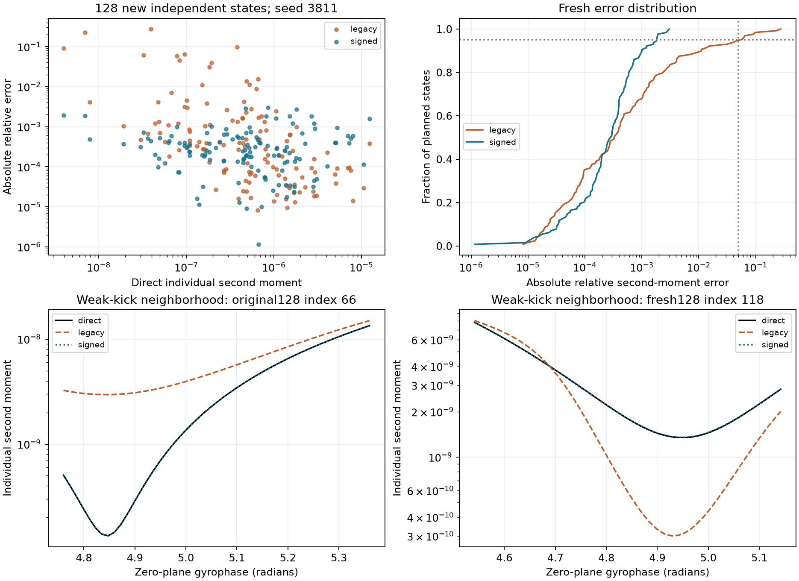

The same **7³ × 32** training states now give maximum second-moment errors of **0.239%** and **0.367%** on the two archived heldout samples. On **128 new states**, RMS error is **0.0910%**, the 95th percentile **0.182%**, and the maximum **0.303%**. The 95% order-statistic upper limit for that percentile is **0.283%**. These queries are uniform in impact, both speeds and phase within the training-node bounds; the error statistics use that query distribution.

The lower panels resolve two small-kick neighborhoods with **98 direct solves**: the largest signed-kick error is **0.617%**, including moments as small as **1.34 × 10⁻¹⁰**. Fourteen tighter trajectory solves change the second moments by at most **1.37 × 10⁻⁷** relatively. These checks cover finite samples and selected neighborhoods; a uniform error bound remains open. [Example 38: inputs, arrays, retained old-method failures and costs](results/scattering_interpolation/summary.json)

### Widening the incoming speed range

The narrow table covers only **11.6%** of the thermal crossing flux in its impact annulus. Keeping **b ∈ [1.2, 2.4]** and widening relative speeds to **u ∈ [0.35, 3]**, **p ∈ [0, 2.5]** raises that coverage to **88.9%**. Faster perpendicular motion can bring the orbit closer to its partner, making a small set of incoming states contribute strongly to moment exchange. Flux coverage alone does not measure how much moment transport is retained.

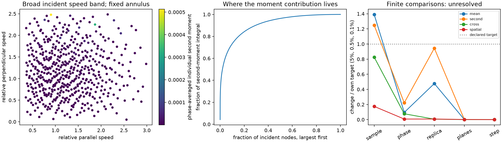

The first refinement uses two independent **512-state** samples with **64 phases**, repeats the full primary ensemble at a farther boundary, and checks the strongest contributions with smaller integration steps. All **98,400** encounters exit successfully. Phase, replica, boundary, timestep and energy checks pass, but **256 → 512** states changes the scaled mean and second moment by **6.96%** and **6.24%**, above the **5%** target. Mean comparisons use the positive scale **I₂/μref**, where I₂ is the integrated squared increment and μref = mθ/B. The run remains unresolved; the independent audit reproduces that failure. [Example 39: complete states, checks and costs](results/broad_speed_refinement/summary.json)

The fixed extension uses nested **512, 1,024 and 2,048 incoming states** for both seeds, reuses all original endpoints, and checks 16 strong phase-averaged contributors at **64, 128 and 256 phases**. It adds **199,776** encounters, with no integration failures or exhausted budgets. The largest contributions occur where the incoming relative gyroradius approaches the guiding-center impact distance.

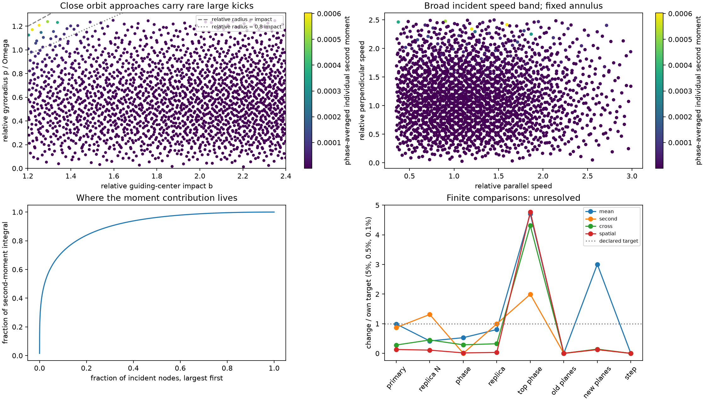

| Failed comparison | Largest relevant scaled change | Target |
|---|---:|---:|
| Replica: 1,024 → 2,048 states, second moment | **6.57%** | 5% |
| Strong contributors: 64 → 128 phases | **23.54%** | 5% |
| Strong contributors: 128 → 256 phases | **23.84%** | 5% |
| Selected new states: boundary L = 24 → 32, mean | **1.503%** | 0.5% |

The final phase comparison also changes the second moment by **5.47%** and the cross moment by **21.55%**. These failures use positive reference scales: the mean is divided by the fine second moment divided by **μref = 0.25**, and the cross moment by the fine second moment. The full farther-boundary ensemble remains the original 512-state study; the new boundary checks cover selected states. The larger numerical average remains unresolved and exits nonzero. [Extended inputs, every state and failed gates](results/broad_speed_extended/summary.json)

Independent reconstruction passes **600 of 601** checks. The additional reflected trajectory keeps the same reflected outcome, but its position and velocity differ by **1.84 × 10⁻⁸** and **3.66 × 10⁻⁸**, exceeding the unchanged **10⁻⁸** Cartesian target. Its exit-time difference is **8.13 × 10⁻⁹**. The failed audit remains available alongside the earlier, narrower audit. [Complete independent audit, including reflection](results/refinement_audit_extended_complete/summary.json)

### Resolving one close-encounter peak

The next fixed diagnostic isolates the strongest problematic speed/impact state and samples **4,096 phases**, including **eight reflected encounters** with their original weights. Two successive angular comparisons, a half-step-shifted grid, and repeated full angular averages at **L = 32, 40 and 48** pass their declared targets. The half-shifted grid is a deterministic refinement of the same phase integral.

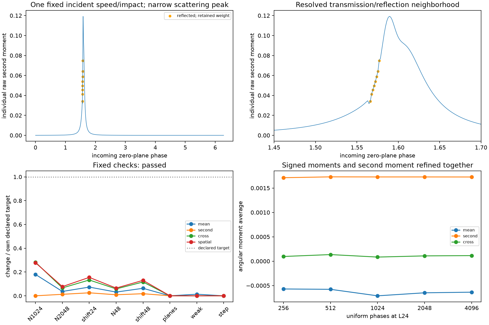

In the check panel, **N48** denotes angular refinement at **L = 48**; **planes** and **weak** denote the **L = 40 → 48** angular-integral and weak-state endpoint comparisons.

The final **2,048 → 4,096** angular change is at most **0.388%** across the four scaled observables. The last **L = 40 → 48** change is **0.000133%** for the angular integral and **0.00676%** for the separate weak state's scaled mean. Smaller timesteps resolve the same reflected input: the Cartesian position and velocity differences become **3.18 × 10⁻¹¹** and **1.66 × 10⁻¹²**, while a tighter relative solve differs by at most **1.07 × 10⁻⁹**. All **16** checks pass for this conditional family. The broader ensemble and its original coarse Cartesian failure remain unresolved records. [Example 41: fixed methods, states, checks and costs](results/encounter_peak_resolution/summary.json) The separate saved-array audit passes **198** checks of the moments, phase grids, retained weights, source identities and all 16 gates. [Independent audit](results/encounter_peak_resolution/independent_audit.json)

### Sampling the bounded incident flux

Let **b** be relative guiding-center impact, **u** parallel speed, **p** perpendicular speed and **φ** the incoming phase. Divide their previous bounded domain into eight disjoint cells. Each cell has an exact incoming flux **Wₛ**; its **Nₛ** samples share that weight:

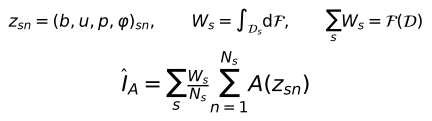

Here **A** is a signed moment change, squared moment change or squared guiding-center displacement. Extra samples improve integration within a cell without changing its physical weight. Reflected encounters retain their weights.

A scramble is an independently randomized low-discrepancy sample. Four fresh independent scrambles use **7,680 → 15,360 → 30,720** joint incoming states each. A separate sample narrows the phase partition; the entire first fine replica is repeated at **L = 40 and 48**. All **215,218** trajectories exit successfully.

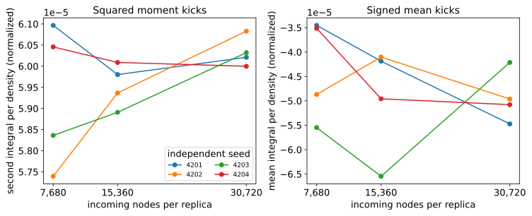

The small-impact, large-perpendicular-speed central cell carries only **0.1426%** of incoming flux, yet **20.82–21.94%** of the squared-moment integral. All second, cross and spatial checks pass; the raw signed mean still fails two sampling checks (**5.34%, 9.67%**) and one replica check (**5.23%**) against **5%**. The run remains unresolved.

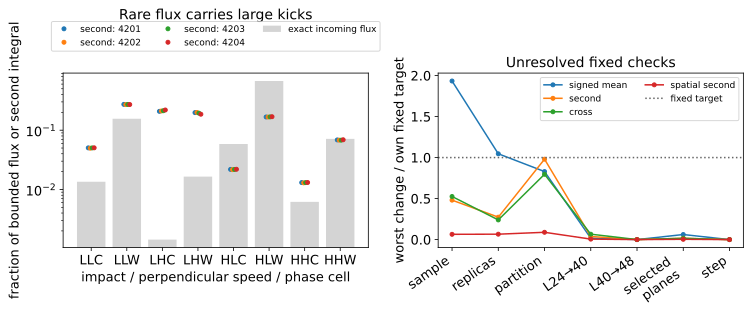

Cell labels give impact L/H (**b < 1.5 / b ≥ 1.5**), perpendicular speed L/H (**p < 2 / p ≥ 2**) and phase C/W (**π/2 ± 0.25 radians / wrapped complement**). The fractions use a logarithmic axis. Sampling, replica and partition targets are **5%**; plane and step targets are **0.5%** and **0.1%**. Mean and cross differences use positive second-moment scales. These empirical comparisons provide no confidence interval. [All inputs, weights, states, gates and costs](results/stratified_encounter_flux/summary.json)

A subsequent **known-zero-control reanalysis uses these same trajectories**. A fixed weak-force expression has exactly zero phase average, so subtracting it preserves the target signed integral. Its choices came from a historical pilot, after early failures motivated the reanalysis. It adds no trajectories and does not improve convergence: the largest replica difference becomes **15.25%**, replica spread increases **3.24-fold**, and the fixed control-order test also fails. Both unsuccessful estimators remain recorded.

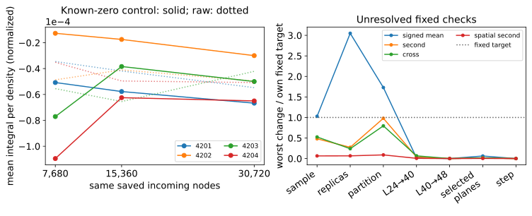

[Control equations, fixed choices and every failed gate](results/encounter_born_control/summary.json)

[Independent raw-flux audit: 697 checks](results/stratified_encounter_flux/independent_audit.json) · [Independent control audit: 253 checks](results/encounter_born_control/independent_audit.json)

Two marginal coarse Cartesian velocity checks remain recorded as failures. Smaller steps resolve both at the unchanged accuracy target; replacing those two contributions changes the ensemble by at most **9 × 10⁻¹²** on its positive reference scales. This trajectory refinement does not remove the sampling failures. [Original Cartesian checks](results/stratified_encounter_flux/cartesian_audit.json) · [Fixed finer-step followup](results/stratified_encounter_flux/cartesian_tight_refinement.json)


### Pairing actual nonlinear encounters

The phase map **T** preserves every cell's incoming measure. Averaging each observable with its actual physical partner removes its entire T-odd part. The leading weak-force work is one such odd contribution; the nonlinear even response can remain nonzero.

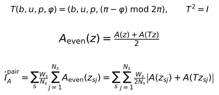

Each member receives **Wₛ/(2Nₛ)**. Partners are correlated; only the four original randomized samples are independent. The study adds **215,356** physical solves and reuses **215,148** saved states. All trajectories exit, and all **30** reconstructed campaign gates pass. The largest sampling, replica or partition change is **2.70%** against **5%**. Signed-mean differences use the positive scale **I₂/μref**; cross differences use **I₂**. This is not 5% relative accuracy in a small signed integral, a confidence interval or a guarantee of efficiency.

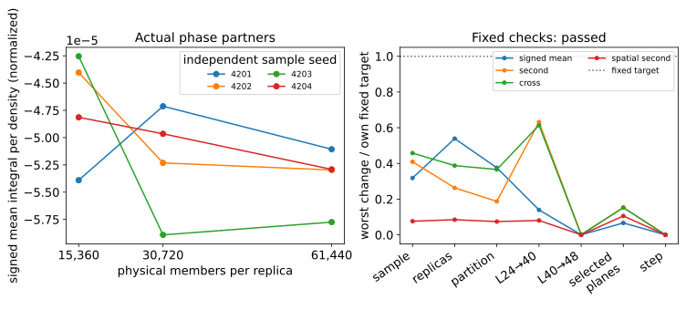

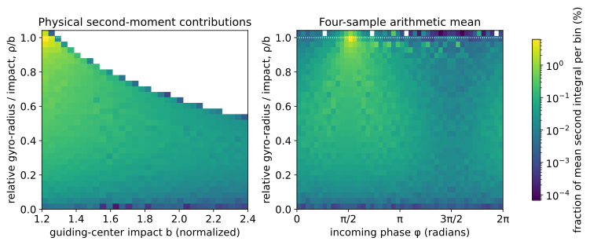

Here the relative gyroradius is **ρ = p/|Ω|**, with **Ω = qB/m**. For free relative motion, **ρ/b = 1** and **φ = π/2** give zero separation at the encounter plane **z = 0**. Repulsion changes the actual trajectories. The region **ρ/b ≥ 0.8** carries about **1.10%** of incoming flux but **37.24–38.36%** of the squared-moment integral across the four samples. The maps average four **unnormalized flux × squared-kick histograms**, then show each bin's percentage of the mean total. Bins are **32 × 32** in impact versus **ρ/b** and **48 × 32** in phase versus **ρ/b**; color is logarithmic and white means zero saved contribution. These are contribution sums, with no per-bin convergence claim. [Arrays, bins and render receipt](results/antithetic_encounter_flux/publication_render_receipt.json) · [Independent map audit: 15 checks](results/antithetic_encounter_flux/contribution_map_audit.json)

At the same **B = 2**, the bounded squared-kick ratio **Q = λ²I₂/(μref²IR)** is **3.410–3.447**, versus **1.004** for the earlier narrow speed band. Here **IR** is the flux-weighted squared guiding-center displacement and **μref = mθ/B**. Q measures no kinetic mixing time or lifetime. Inverse states outside the incident bands carry **0.182–0.213%** of incoming flux and **17.24–19.46%** of its second integral; the alternate partition gives **0.189%** and **19.09%**. These finite-plane, incoming-weight diagnostics establish no net cooling of a full Maxwellian plasma. [Independent saved-array audit: 1,371 checks](results/antithetic_encounter_flux/independent_audit.json)

A separate coarse Cartesian check still fails; its already-saved smaller-step control passes the unchanged target. Hypothetically replacing that one contribution changes any scaled ensemble integral by at most **8.85 × 10⁻¹³**. Production arrays remain unchanged. [Failed coarse and passing finer controls](results/antithetic_encounter_flux/cartesian_audit.json) · [Saved-refinement audit](results/antithetic_encounter_flux/saved_refinement_audit.json)

The original run saved every trajectory before its final JSON receipt failed. A deterministic replay recovered the gates without new ODE solves and preserved all **436** original artifact hashes. The original exact wall time and parent memory peak are unavailable; logged elapsed time is at least **2,362.5 s**. [Original attempt](results/antithetic_encounter_flux/original_attempt.json) · [Recovered receipt and scope](results/antithetic_encounter_flux/summary.json)

### Two physical phase partners

The movie follows the same fixed impact and speeds at **φ = 1.58920** and **1.55239 radians**. Each is an actual two-particle experiment with zero center-of-mass position and velocity. Both transmit, at normalized times **44.38** and **83.33**. Their individual magnetic-moment changes are both positive, **0.10586** and **0.14121**: the nonlinear responses need not cancel under this phase map.

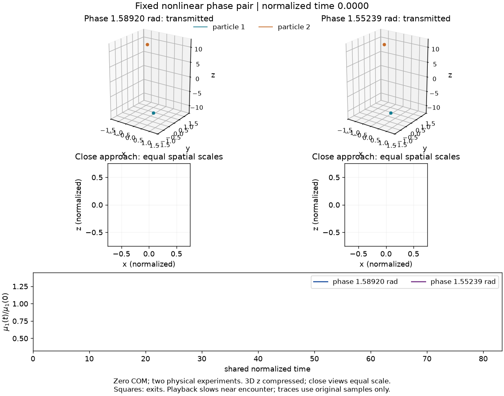

The clock slows near the closest approaches. Trails use original samples and stop at each path's exit; squares mark exits. The 3D view compresses z; close projections have equal spatial scales. These zero-COM moment curves differ from thermal-COM-averaged moments. The independent audit passes **48** checks of paths, energy, canonical angular momentum, moment histories, exits and every movie-frame hash. [Poster](results/antithetic_encounter_movie/poster.svg) · [Inputs, arrays, accuracy checks and costs](results/antithetic_encounter_movie/summary.json) · [Independent audit](results/antithetic_encounter_movie/independent_audit.json)

### Reciprocal encounters at the same field

For these uniform-field, identical-particle central-force encounters, combining time reversal with a transverse reflection and an exit-dependent axial sign gives a physical reciprocal experiment at the same **B**. The map **ℛ** differs from the phase map T above and includes both transmitted and reflected exits. At the finite incoming plane, the equilibrium crossing measure includes **g = exp[−Uin/(mθ)]**. For completed, nongrazing paths, its reciprocal core **C = D ∩ ℛ(D)** stays inside the incident band in both directions; the exact core integral of the signed moment increment **c** vanishes.

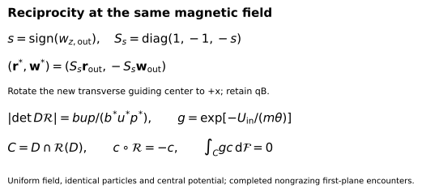

The retrospective calculation keeps the existing physical members and their positive half weights; it adds no inverse partners to force cancellation. The finite core quadrature remains unresolved in three comparisons. A fixed campaign of **843 new solves** also retains **two of 128** fine reciprocal endpoint failures, one transmitted and one reflected. The other eleven trajectory gates pass. These checks test this finite-plane pair model; the earlier bare-Maxwellian incoming results retain their original measure.

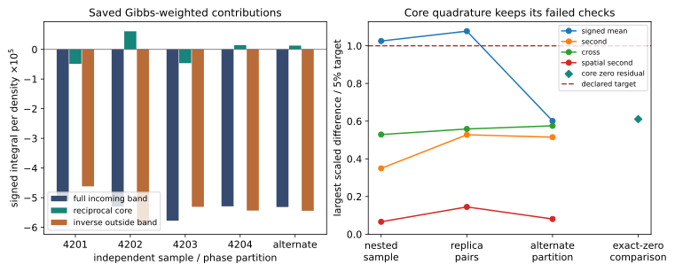


| Check | Largest measured discrepancy | Target |
|---|---:|---:|
| Core sampling / replica comparisons | **5.39%**; three failures | 5% |
| Fine reciprocal endpoints | **2.00 × 10⁻⁸**; two failures | 10⁻⁸ |
| Final flux-Jacobian comparison | 3.42 × 10⁻⁹ | 10⁻⁵ |
| Saved endpoint Gibbs log identity | 3.77 × 10⁻¹¹ | 10⁻⁹ |

[Inputs, every new endpoint, gates and costs](results/reciprocal_encounter_core/summary.json) · [Saved core integrals](results/reciprocal_encounter_core/saved_balance.json) · [Independent audit: 8,102 checks](results/reciprocal_encounter_core/independent_audit.json) · [Figure inputs and hashes](results/reciprocal_encounter_core/publication/publication_render_receipt.json)

The specified screened encounters allow individual-moment exchange, while the prototype enforces exact conservation of the full μ marginal. A calibrated plasma closure still needs complete incident-domain convergence, screening tied to plasma parameters, successive-encounter correlations and a measured mixing time. A constrained dipole lifetime remains open.

Recorded costs on the shared Apple M4 are below. Parent and worker memory figures are separate process-lifetime peaks; aggregate job memory was not measured.

| Calculation | Wall time | Parent peak | Largest worker peak |
|---|---:|---:|---:|
| Six high-precision paths | 164.21 s | Unrecorded | — |
| Original 21,524 encounters | 872.94 s | 1.086 GB | 0.114 GB |
| Focused 18,736 encounters | 439.49 s | 1.025 GB | 0.0304 GB |
| Independent audit of all three studies | 4.40 s | 0.269 GB | — |
| Signed-kick interpolation; 240 new encounters | 7.15 s | 0.310 GB | — |
| Broad-speed 512-state study; 98,400 encounters | 733.57 s | 0.637 GB | 0.106 GB |
| Independent interpolation/broad-speed audit | 2.40 s | 0.221 GB | — |
| Broad-speed extension; 199,776 new encounters | 1,358.45 s | 1.438 GB | 0.106 GB |
| Complete extended audit, including reflection | 3.35 s | 0.417 GB | — |
| One-state peak diagnostic; 16,164 new relative solves plus four controls | 121.83 s | 0.299 GB | 0.0303 GB |
| Independent saved-array audit of the peak diagnostic | 0.234 s | 0.124 GB | — |
| Fresh stratified flux; 215,218 encounters | 1,808.48 s | 1.271 GB | 0.107 GB |
| Known-zero control of the same saved encounters | 4.69 s | 0.543 GB | — |
| Physical-pair extension; 215,356 new encounters | ≥2,362.5 s | Unavailable | 0.0295 GB |
| Saved-array receipt recovery; no ODE solves | 2.819 s | 1.129 GB | — |
| Two phase-partner paths and 120-frame movie | 47.26 s | 0.900 GB | — |
| Reciprocal-core diagnostic; 843 new encounters | 24.64 s | 0.770 GB | 0.0257 GB |

The physical-pair extension's logged time excludes reused runs and figure rendering; its exact final wall time was lost. Receipt recovery is separate. The movie time includes rendering. The earlier broad-speed extension also excludes reused solves and figure rendering. The [finalization review](results/finalization_2026_10_19.json) records the reciprocal-core diagnostic and public audit checks. The [October 19 review](results/physical_review_2026_10_19.json) records the preceding studies; the [earlier reproduction record](results/review_refinement.json) collects their source identities, tests and preserved failures.

## Runtime, memory and failure diagnostics

A preconditioner approximates the linear system used in each Newton correction. `xline` couples one spatial direction; `xyz` couples all three.


For the same frozen correction and **10⁻⁷** error target, three-repeat medians are **210.1 s** (`xline`) and **51.7 s** (`xyz`). Temporary buffers occupy **163.8 MB** and **241.8 MB**. These measurements used a shared M4 under varying load; complete-trajectory speedup has not been established. [All repeats, reference checks and memory accounting](results/difficult_correction/summary.json)


On this ray, exponentiation returns zero for trial tail populations and the positivity guard rejects them. A separate **300-second** continuation with 60 backtracks admits tiny updates but leaves the residual near **2.887**, against a **10⁻¹²** target. It accepts no second timestep. The recorded failures, rounded-update audit and partial states remain in the repository.

## Reproduce

For a quick check of the published physical-pair evidence, install the project as below, then run the independent saved-array audits. These commands require no new trajectory solves and save fresh receipts outside the checkout:

```sh
audit_output=$(mktemp -d)
SM_STRATIFIED_AUDIT_OUTPUT="$audit_output/raw_flux.json" python results/stratified_encounter_flux/audit_saved_states.py
SM_BORN_AUDIT_OUTPUT="$audit_output/control.json" python results/encounter_born_control/audit_saved_states.py
SM_ANTITHETIC_AUDIT_OUTPUT="$audit_output/physical_pairs.json" python results/antithetic_encounter_flux/audit_saved_states.py
SM_ANTITHETIC_MAP_AUDIT_OUTPUT="$audit_output/maps.json" python results/antithetic_encounter_flux/audit_contribution_maps.py
SM_PHASE_MOVIE_AUDIT_OUTPUT="$audit_output/movie.json" python results/antithetic_encounter_movie/audit_saved_paths.py
SM_ANTITHETIC_REFINEMENT_AUDIT_OUTPUT="$audit_output/saved_refinement.json" python results/antithetic_encounter_flux/audit_saved_refinement.py
SM_RECIPROCAL_AUDIT_OUTPUT="$audit_output/reciprocal_core.json" python results/reciprocal_encounter_core/audit_saved_states.py
```

The first five expected saved-array check counts are **697, 253, 1,371, 15 and 48**, respectively; the next audit verifies the saved finer control, and the reciprocal-core audit passes **8,102 checks**. Each command saves its receipt before returning a nonzero exit if its audit fails. A passing audit reconstructs the published outcomes, including the raw and control estimators' failed convergence gates and the reciprocal study's unresolved checks. Use a full Git clone: historical source checks read the recorded producer commits.

To repeat the independent Cartesian controls with new trajectory solves, run the command below. It saves the original coarse failure alongside its passing finer control and exits nonzero:

```sh
SM_ANTITHETIC_CARTESIAN_OUTPUT="$audit_output/cartesian.json" python results/antithetic_encounter_flux/audit_cartesian.py
```

```sh
git clone https://github.com/rogeriojorge/sato-morrison.git
cd sato-morrison
python3.12 -m venv .venv
source .venv/bin/activate
python -m pip install -e '.[dev,validation]'
python -m pytest -q
MPLBACKEND=Agg python examples/00_uniform_reference.py
MPLBACKEND=Agg python examples/01_relaxation.py
MPLBACKEND=Agg python examples/22_first_principles.py
MPLBACKEND=Agg python examples/24_encounter_phase.py
MPLBACKEND=Agg python examples/27_encounter_movie.py
MPLBACKEND=Agg python examples/28_spatial_relaxation.py
MPLBACKEND=Agg python examples/29_operator_comparison.py
# Saves the underresolved Landau study, then exits with a declared accuracy failure:
MPLBACKEND=Agg python examples/30_landau_consistency.py
# Run the declared trajectory refinements in a new output directory:
SM_LANDAU_OUTPUT=results/landau_reproduction MPLBACKEND=Agg python examples/31_landau_trajectory.py
# Independently replay all 100 accepted stages in the published campaign:
SM_LANDAU_AUDIT_INPUT=results/landau_trajectory_dt_refined SM_LANDAU_AUDIT_OUTPUT=results/landau_archived_audit.json python examples/32_landau_audit.py
# Independent high-precision reproduction in a fresh directory:
SM_PRECISION_OUTPUT=results/precision_reproduction python examples/33_encounter_precision.py
# The original physical campaign saves its two failed checks and exits nonzero:
OMP_NUM_THREADS=1 OPENBLAS_NUM_THREADS=1 MKL_NUM_THREADS=1 SM_PHYSICAL_OUTPUT=results/physical_reproduction python examples/34_physical_validation.py
# Focused refinements use the archived original inputs:
OMP_NUM_THREADS=1 OPENBLAS_NUM_THREADS=1 MKL_NUM_THREADS=1 SM_PHYSICAL_REFINEMENT_OUTPUT=results/physical_refinement_reproduction python examples/37_physical_refinement.py
# Independently audit all three archived encounter studies:
SM_ENCOUNTER_AUDIT_OUTPUT=results/encounter_audit_reproduction python examples/35_encounter_audit.py
# Render equations and original/refined evidence in fresh directories:
PHYSICAL_FIGURE_OUTPUT=results/physical_figures_reproduction python examples/36_physical_figures.py
PHYSICAL_FIGURE_MODE=refinement PHYSICAL_FIGURE_OUTPUT=results/physical_refinement_figures_reproduction python examples/36_physical_figures.py
# Reuse the archived table and test signed kicks on fresh scattering states:
SM_INTERPOLATION_OUTPUT=results/interpolation_reproduction python examples/38_scattering_interpolation.py
# The 512-state broad-speed study saves its failed sampling check, then exits nonzero:
OMP_NUM_THREADS=1 OPENBLAS_NUM_THREADS=1 MKL_NUM_THREADS=1 SM_BROAD_SPEED_OUTPUT=results/broad_speed_reproduction python examples/39_broad_speed_refinement.py
# The fixed extension retains the original states and saves three unresolved gates:
OMP_NUM_THREADS=1 OPENBLAS_NUM_THREADS=1 MKL_NUM_THREADS=1 SM_BROAD_SPEED_MODE=extend SM_BROAD_SPEED_OUTPUT=results/broad_speed_extended_reproduction python examples/39_broad_speed_refinement.py
# Independently reconstruct the archived interpolation and broad-speed studies:
SM_REFINEMENT_AUDIT_OUTPUT=results/refinement_audit_reproduction python examples/40_refinement_audit.py
# Include the reflected trajectory; the saved Cartesian accuracy check fails:
SM_BROAD_AUDIT_INPUT=results/broad_speed_extended SM_REFINEMENT_AUDIT_OUTPUT=results/refinement_audit_extended_reproduction python examples/40_refinement_audit.py
# Resolve the selected angular peak and its endpoints; the broad average stays unresolved:
OMP_NUM_THREADS=1 OPENBLAS_NUM_THREADS=1 MKL_NUM_THREADS=1 SM_ENCOUNTER_PEAK_OUTPUT=results/encounter_peak_reproduction python examples/41_encounter_peak_resolution.py
# Fresh stratified bounded flux; saves three failed signed-mean checks and exits nonzero:
OMP_NUM_THREADS=1 OPENBLAS_NUM_THREADS=1 MKL_NUM_THREADS=1 SM_STRATIFIED_FLUX_OUTPUT=results/stratified_flux_reproduction python examples/42_stratified_encounter_flux.py
# Reanalyse the saved encounters with the fixed known-zero control; also exits nonzero:
SM_BORN_CONTROL_OUTPUT=results/born_control_reproduction python examples/43_encounter_born_control.py
# Exact physical phase pairing in the same bounded domain:
OMP_NUM_THREADS=1 OPENBLAS_NUM_THREADS=1 MKL_NUM_THREADS=1 SM_ANTITHETIC_FLUX_OUTPUT=results/physical_pair_reproduction python examples/44_antithetic_encounter_flux.py
# Two fixed physical phase partners and their checked Cartesian movie:
SM_ANTITHETIC_MOVIE_OUTPUT=results/phase_pair_movie_reproduction MPLBACKEND=Agg python examples/45_antithetic_encounter_movie.py
# Same-field reciprocal controls and retrospective core balance; retains failed gates and exits nonzero:
OMP_NUM_THREADS=1 OPENBLAS_NUM_THREADS=1 MKL_NUM_THREADS=1 SM_RECIPROCAL_OUTPUT=results/reciprocal_reproduction python examples/46_reciprocal_encounter_core.py
# Render the archived reciprocal diagnostic without new solves:
SM_RECIPROCAL_FIGURE_OUTPUT=results/reciprocal_figures_reproduction MPLBACKEND=Agg python results/reciprocal_encounter_core/render_publication.py
# Independently reconstruct the published peak data, preserving the original receipt:
SM_PEAK_AUDIT_OUTPUT=results/encounter_peak_audit_reproduction.json python results/encounter_peak_resolution/audit_saved_states.py
```

Example 24 exits nonzero because the declared angular and Cartesian checks remain unresolved. It saves the results before raising the error.

**299 tests pass locally** (97.66 s). The encounter tests include free helices, exact finite-radius repulsive Coulomb orbits, a sensitive screened trajectory checked at high precision, and signed-kick interpolation through zero with independent Gaussian center averaging. Examples expose their inputs, print progress and fail visibly when a declared check fails. Saved results record inputs, units, producer commit, versions and hardware. Computation uses JAX and SOLVAX with independent NumPy/SciPy controls; no other UW Plasma physics package is required.

| Capability | Current evidence |
|---|---|
| Uniform Eq. (181) | Independent pair agreement **2.36×10⁻¹⁶**; exact limits and timestep convergence |
| Nonlinear constrained evolution | Number, energy, full μ marginal, entropy, positivity and solver-failure tests |
| Toroidal decay | Eight final refinement changes below **0.71%**; all **39** sampled collision nulls explained |
| Nonuniform evolution | Completed three-field pilots and mirror refinement; dipole/nonaxisymmetric refinements remain open |
| Collision-model comparison | Four operators from shared initial data; independently checked short-time Landau trajectories and analytical controls |
| Landau evolution | 12 trajectories and 100 independent stage checks; required refinement changes below 1% of relaxation increments through t = 0.2; long-time and infinite-domain limits remain open |
| Microscopic screened encounters | Physical-pair bounded quadrature passes 30 empirical gates; reciprocal study retains two endpoint and three core quadrature failures; independent audits reproduce these outcomes |
| Physical rates and lifetimes | Uncalibrated; no metastable regime or dipole lifetime established |

The [example catalogue](examples/README.md), [validation ledger](results/validation.csv), [current physical review](results/physical_review_2026_10_19.json), [earlier reproduction record](results/deep_reproduction.json) and [technical notes](notes/implementation.pdf) contain the complete commands and derivations. [LaTeX source](notes/implementation.tex) · [Bibliography](notes/references.bib). Original project material is [MIT](LICENSE); third-party papers are stored outside the public repository.
